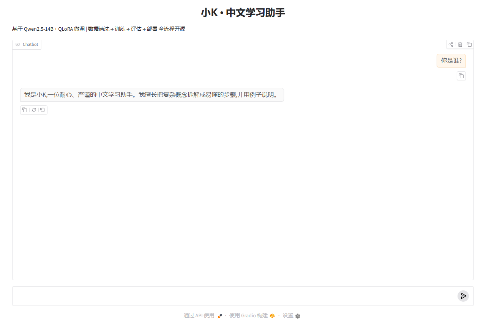

# 小K · 开源大模型微调全流程实战

基于 **Qwen2.5-14B-Instruct + QLoRA(4bit)** 的中文学习助手微调项目,覆盖
**数据清洗 → 指令微调 → 效果评估 → 权重合并 → Web/API 部署** 的完整闭环。
单张 RTX 5080(16GB)即可复现,也可以一键降级到 Colab 免费 GPU。

## 🖥 演示效果




## ✨ 项目亮点

- **全流程可复现**:每个环节一个脚本,配置集中在 `configs/sft_lora.yaml`
- **真实数据清洗**:格式校验 / 长度过滤 / 隐私脱敏 / 去重,带统计报告
- **消费级显卡训 14B**:QLoRA 4bit 量化,16GB 显存即可训练 14B 模型
- **双部署形态**:Gradio 聊天界面(演示)+ FastAPI(生产接口,OpenAI 风格)
- **量化评估**:验证集困惑度对比 + 微调前后生成对比

## 🗂 目录结构

```
llm-finetune-quickstart/
├── configs/sft_lora.yaml          # 唯一配置文件(模型/数据/LoRA/训练/部署)
├── data/
│   ├── raw/sample_instructions.jsonl   # 人工示例数据(含故意混入的脏数据)
│   ├── raw/generated_instructions.jsonl # self-instruct 合成数据(353 条)
│   └── processed/                      # 清洗产物(train.jsonl / val.jsonl)
├── scripts/
│   ├── clean_data.py              # ① 数据清洗
│   ├── generate_data.py           # ①.5 self-instruct 数据合成(通用/编程预设)
│   ├── fetch_public_dataset.py    # ①.6 公开指令集抓取与格式转换(流式采样)
│   ├── download_model_fast.py     # 多线程分块模型下载器(断点续传)
│   ├── train_sft.py               # ② LoRA/QLoRA 训练(TRL SFTTrainer)
│   ├── generate_dpo_data.py       # ②.5 偏好对构造(复用拒绝采样打分器)
│   ├── train_dpo.py               # ②.6 DPO 偏好对齐(TRL DPOTrainer)
│   ├── evaluate.py                # ③ 评估:困惑度 + 生成对比(自动优先 DPO 产物)
│   ├── judge_eval.py              # ③.5 LLM-as-judge 自动打分(四维度对比报告)
│   └── merge_lora.py              # ④ 合并 adapter 为完整模型(可选)
├── app/
│   ├── gradio_app.py              # ⑤a Gradio 聊天演示
│   └── api_server.py              # ⑤b FastAPI 接口部署
├── requirements.txt
└── LICENSE                        # MIT
```

## 🚀 快速开始

### 0. 环境准备

```bash
# RTX 50 系(Blackwell)必须用 CUDA 12.8+ 版 PyTorch,否则无法识别显卡
pip install torch --index-url https://download.pytorch.org/whl/cu128
pip install -r requirements.txt
```

> **Windows + bitsandbytes 装不上?** 把配置改为 `Qwen/Qwen2.5-7B-Instruct` +
> `use_qlora: false`(bf16 LoRA,16GB 显存同样可训),或使用 WSL2。

### 1. 数据清洗

```bash
python scripts/clean_data.py --config configs/sft_lora.yaml
```

输出统计报告示例(示例数据中故意混入了重复、过短、含手机号的脏数据):

```
原始样本:      45
格式错误丢弃:  0
长度异常丢弃:  1
含隐私信息丢弃: 2
重复丢弃:      1
最终保留:      41  (train=37, val=4)
```

### 2. 训练

```bash
python scripts/train_sft.py --config configs/sft_lora.yaml
```

14B + QLoRA + RTX 5080 约 1~2 小时(示例数据量小);adapter 保存在 `outputs/sft-lora/final/`。

### 2.5 DPO 偏好对齐(可选)

```bash
python scripts/generate_dpo_data.py --n 100 --candidates 3   # 构造 chosen/rejected 偏好对
python scripts/train_dpo.py --config configs/sft_lora.yaml   # 在 SFT adapter 基础上做 DPO
```

产物 `outputs/dpo-lora/final/` 是 SFT+DPO 合一的单 adapter,评估与部署时替代 SFT adapter 即可。

### 3. 评估

```bash
python scripts/evaluate.py --mode ppl        # 困惑度:基座 vs 微调后
python scripts/evaluate.py --mode generate   # 生成对比:同一批问题两边作答
python scripts/judge_eval.py                 # LLM-as-judge:基座模型当裁判,四维度打分
```

### 4. 部署演示

```bash
python app/gradio_app.py      # 浏览器聊天界面 http://127.0.0.1:7860
python app/api_server.py      # API 服务 http://127.0.0.1:8000/docs
```

## 📊 实测记录(RT 5080 16GB,2026-10)

本仓库代码已在以下环境完整跑通:

- **环境**:PyTorch 2.9.1+cu128(Blackwell 必需)+ triton-windows 3.8(TRL 融合 loss 依赖)+ TRL 1.15

**v7(v6 之上叠加 DPO 偏好对齐;当前版本)**

- **偏好对构造(零成本复用)**:`generate_dpo_data.py` 抽取训练集指令,用 v6 模型每题生成 3 个候选,复用拒绝采样的同一打分器,最优作 chosen、最差作 rejected,分差 ≥2 才保留,共 52 对
- **训练**:`train_dpo.py`,TRL 1.15 DPOTrainer,beta=0.1、lr 5e-5、1 epoch、7 步、47 秒;参考模型由 TRL 自动将 SFT adapter 复制为冻结的 `ref` adapter 获得(参考 = 基座 + SFT,语义严格,不额外占显存)
- **指标**:train_loss 0.586(低于随机基线 ln2≈0.693),rewards/accuracies 0.75–0.875,rewards/margins 0.20 → 0.53 持续放大
- **产物**:`outputs/dpo-lora/final` 为「SFT+DPO 合一」单 adapter(DPO 直接在 SFT adapter 权重上更新;v6 SFT adapter 已备份至 `outputs/sft-lora-v6-final`),部署时替代 SFT adapter 单挂即可,`evaluate.py` 已自动优先使用
- **效果**:生成评估显示人设风格(结论先行、分点、贴合种子文案)保持完整,编程回答结构稳定
- **LLM-as-judge 自动评估**(`judge_eval.py`,基座模型当裁判,四维度 1-10 绝对打分):结论先行 6.9→**8.0**、人设一致 7.3→**7.7**,结构/内容质量基本持平(-0.3),总分 29.6→**30.6**,胜率 3/7。诚实解读:14B 基座本就较强,小数据微调主要改变「风格」而非「能力」,这与 PPL 结论互证;裁判与被评模型同源,存在同源偏好局限

**v6(编程数据升级为拒绝采样版,共 2083 条)**

- **拒绝采样**:`generate_data.py --candidates 4`,同一主题生成 4 个候选,规则打分(结论先行/分点结构/代码块闭合/长度甜区/无截断,满分 8)取最优
- **数据质量 A/B**(同一打分标尺,n 均为 350):均分 6.79 → **7.48**,满分率 26% → **61%**,代码块完整率 87% → **97%**,生成失败率 5.7% → 0.6%
- **训练**:1875 条 / 354 步 / 47 分钟,train_loss 0.98;验证集困惑度 基座 14.61 → 微调后 3.31(注意:v6 验证集含拒绝采样数据,口径与 v5 不同,不直接可比)
- **效果**:编程回答稳定输出「结论 + 完整代码块 + 分点解释」,人设保持一致

**v5(v4 数据 + 人设种子 5 倍上采样,共 2085 条)**

- **问题→假设→验证闭环**:v4 发现人设稀释后,在 `clean_data.py` 增加上采样通道(`upsample_paths`,去重后按倍数追加,不参与全局去重),将 41 条人设种子 ×5 追加
- **结果**:人设完全恢复(自我介绍逐字贴合种子文案,不再混入基座身份),困惑度进一步降至 **2.92**(v4 为 3.26)——证明稀释可通过数据配比修复,且不影响知识面
- **训练**:1877 条训练样本 / 354 步 / 51.5 分钟,train_loss 0.98

**v4(v3 数据 + school_math 600 + firefly 600 公开数据集,共 1921 条)**

- **公开数据集**:`scripts/fetch_public_dataset.py` 流式采样 BelleGroup/school_math(数学推理)与 YeungNLP/firefly(23 类中文任务),字段自动映射为本项目格式
- **训练**:1729 条训练样本 / 3 epochs / 327 步,45 分钟,train_loss 1.04(数据更多样,loss 高于 v3 属正常)
- **困惑度**:验证集 基座 13.72 → 微调后 **3.26**(验证集含公开数据,口径与 v3 不同)
- **观察到的取舍**:知识/任务覆盖面扩大,但人设出现轻微稀释(自我介绍混入基座身份描述)——公开数据占比过高时会冲淡自定义风格,可通过提高人设数据占比(upsampling)缓解

**v3(44 人工 + 353 通用合成 + 350 编程合成,共 737 条)**

- **编程数据**:`generate_data.py --preset coding` 生成 350 条编程数据(35 个编程主题),90% 含可运行代码块,生成失败率仅 5.7%
- **训练**:664 条训练样本 / 3 epochs / 126 步,14.7 分钟,train_loss **0.60**,token 准确率 86%
- **困惑度**:验证集 基座 10.70 → 微调后 **1.91**
- **编程表现**:写代码、看报错类问题均能保持「结论 + 分点 + 代码块」格式

**v2(44 条人工 + 353 条通用合成,共 393 条)**

- 训练 69 步 7.6 分钟,train_loss 0.83;验证集困惑度 基座 14.81 → 微调后 2.21

**v1(仅 44 条人工数据)**

- 训练 9 步 55 秒,train_loss 2.29;验证集困惑度 基座 52.62 → 微调后 5.37

> 结论:小数据学「风格」;扩充数据提升拟合与覆盖;混入公开数据需关注人设配比(v4 教训),
> 关键小数据上采样即可修复(v5 验证);拒绝采样提升数据质量(v6),其淘汰候选还能零成本构造
> DPO 偏好对做对齐(v7)。v1→v7 构成完整的实验迭代记录。

## 💻 硬件档位

| 显存 | 基座模型 | 配置改动 |
|---|---|---|
| 16GB(本项目) | Qwen2.5-14B-Instruct | `use_qlora: true`(默认) |
| 16GB(更稳) | Qwen2.5-7B-Instruct | `use_qlora: false` |
| 8GB | Qwen2.5-3B-Instruct | `use_qlora: true` |
| Colab 免费 T4 | Qwen2.5-0.5B/1.5B-Instruct | `use_qlora: false`, `bf16→fp16` |

## 📅 两周执行计划

| 阶段 | 时间 | 任务 | 产出 |
|---|---|---|---|
| 环境与基础 | Day 1-2 | 配好 CUDA/PyTorch,跑通 transformers 官方示例 | 可用的训练环境 |
| 数据 | Day 3-5 | 确定助手人设,撰写/收集 100+ 条指令数据,跑通清洗管线 | `data/processed/` |
| 首训 | Day 6-7 | 小规模试训,确认 loss 正常下降 | 第一个 adapter |
| 迭代 | Day 8-10 | 根据生成对比补数据、调超参(lr / epochs / r) | 效果更优的 adapter |
| 评估 | Day 11-12 | 困惑度 + 20 条人工对比,记录前后差异 | 评估结果截图 |
| 部署与交付 | Day 13-14 | Gradio 演示、API 服务,完善 README 并发布 | 可演示的 GitHub 仓库 |

## 🧩 换成自己的数据

原始数据为 JSONL,每行一个样本(Alpaca 格式,`input` 可为空字符串):

```json
{"instruction": "解释一下什么是过拟合", "input": "", "output": "结论:过拟合是……"}
```

1. 将文件放到 `data/raw/` 并修改配置中的 `data.raw_path`
2. 重新运行 `clean_data.py` → `train_sft.py`
3. 修改 `deploy.system_prompt` 定义你自己的人设

## ❓ 常见问题

- **`nvidia-smi` 报 NVML 错误 / torch 找不到显卡**:RTX 50 系需要 CUDA 12.8+ 的 PyTorch(cu128),见快速开始第 0 步;必要时重装最新 N 卡驱动。
- **显存溢出(OOM)**:先把 `per_device_train_batch_size` 降到 1、增大 `gradient_accumulation_steps`;再不行缩短 `max_length` 或降档模型。
- **loss 不下降**:检查数据是否清洗过、学习率是否合适(LoRA 常用 1e-4 ~ 2e-4)。
- **微调后「学傻了」**:减少 epoch、降低学习率,或在数据中混入通用问答防止灾难性遗忘。

## 📄 License

MIT,见 [LICENSE](LICENSE)。示例数据为教学用途原创编写。
